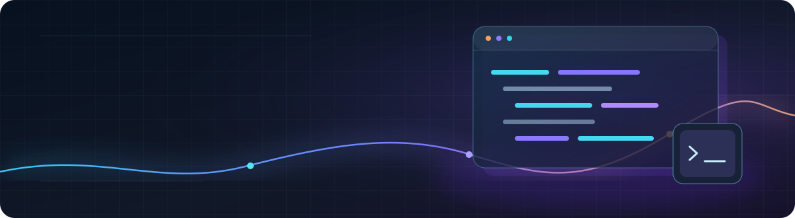

# Hi, I’m Mohamed Ali

### Full-Stack Developer | Backend-Focused Software Engineer

I build scalable backend architectures, high-performance REST APIs, database systems, and end-to-end web applications with modern cloud and AI integrations.

---

## About Me

- **Full-Stack Developer | Backend-Focused Software Engineer** based in **Egypt**.
- Strong emphasis on **Node.js, Express.js, TypeScript, RESTful APIs, and Database Modeling**.
- Extensive hands-on experience with **PostgreSQL, MongoDB, MySQL, and Redis Caching**.
- Infrastructure, containerization, and cloud practices with **Docker, AWS, and CI/CD pipelines**.
- Practical experience in integrating **AI workflows and LLM-powered capabilities** into scalable web applications.
- **Education:** Bachelor of Management Information Systems (MIS) — **El Shorouk Academy** (2019 – 2023).
- **Specialized Diploma:** Digital Pioneers Initiative (**Digilians**) — AI-Powered Software Development Track (9-month intensive diploma).

## Tech Stack

**Backend & Data**  

**Cloud, DevOps & Containers**  

**Frontend**  

## Featured Projects

<table>
  <tr>
    <td width="33%" valign="top">
      <h3>Avicena Platform</h3>
      
A comprehensive healthcare platform with backend engineering, real-time communication via WebSockets, AI assistance, and containerized deployment.

      <a href="https://github.com/Mohamedali409/avicena-platform">GitHub Repository</a>
        
      Node.js · Express · TypeScript · PostgreSQL · Docker · WebSockets
    </td>
    <td width="33%" valign="top">
      <h3>FitMate AI</h3>
      
An intelligent fitness application featuring automated nutrition tracking, tailored workout plans, progress visualization, and AI coaching.

      <a href="https://github.com/Mohamedali409/FitMate-AI">GitHub Repository</a>
        
      Node.js · Express · MongoDB · AI Integration · RESTful APIs
    </td>
    <td width="33%" valign="top">
      <h3>ImpersonaGuard</h3>
      
A security-oriented brand impersonation detection engine designed to detect spoofing, phishing attempts, and fraudulent domains.

      <a href="https://github.com/Madoo2414/ImpersonaGuard-">GitHub Repository</a>
        
      Node.js · Security Hardening · Heuristic Analysis · REST APIs
    </td>
  </tr>
</table>

## Education & Training

- **Bachelor of Management Information Systems (MIS)** — El Shorouk Academy (2019 – 2023)
- **AI-Powered Software Development Track (9-Month Diploma)** — Digital Pioneers Initiative (Digilians) / MCIT

## نبذة بالعربي

أنا **محمد علي**، مطور برمجيات Full-Stack مع تركيز عميق على هندسة الـ Backend. متخصص في تطوير خدمات خلفية قوية وواجهات برمجية RESTful باستخدام Node.js وExpress وTypeScript، وبناء قواعد البيانات وتأمينها (PostgreSQL، MongoDB، MySQL، Redis)، وإدارة الحاويات باستخدام Docker ومبادئ DevOps والحوسبة السحابية (AWS). حاصل على بكالوريوس نظم معلومات إدارية من أكاديمية الشروق ودبلومة متقدمة في تطوير البرمجيات بالذكاء الاصطناعي من مبادرة رواد مصر الرقمية (Digilians).

---

  Engineering scalable backend systems, resilient APIs, and reliable applications.

